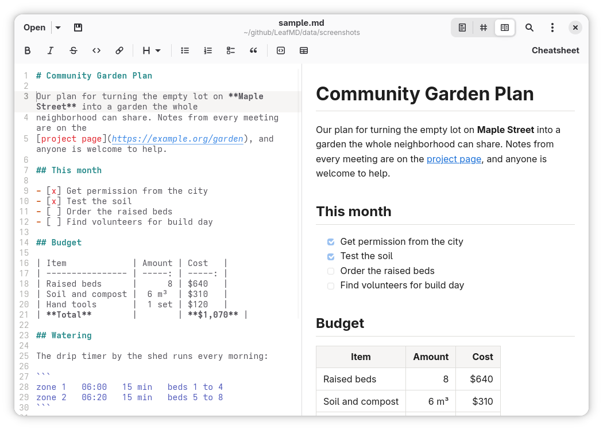

# LeafMD



> **Early days:** LeafMD is a very new app and is in active, early development. It works, but expect rough edges, missing features and changes from one version to the next. Bug reports and ideas are welcome in [Issues](https://github.com/jeremehancock/LeafMD/issues), and [ROADMAP.md](ROADMAP.md) shows what's coming.

A markdown viewer and editor for Linux with three views, including a formatted-only view for pure reading. Switch views with the icons in the toolbar or Ctrl+1, 2 and 3.

- **Formatted:** the rendered document, full window. Just for reading.
- **Raw:** the markdown text, full window. Type here to edit.
- **Split:** raw text on the left, formatted on the right. The formatted side updates as you type.

The raw text can always be edited in Raw and Split view, and changes are only written to the file when you save.

- **Formatting bar:** in Raw and Split view, a row of buttons above the text adds the markdown for you: bold, italic, strikethrough, inline code, links, headings, bulleted, numbered and check lists, quotes, code blocks and tables. Select some text and press a button, or press it with nothing selected to format the word or line the cursor is on. Press it again to take the formatting off.
- **Markdown cheatsheet** (Shift+F1, or the Cheatsheet button) shows the most common markdown next to what it looks like.
- **Lists continue as you type:** press Enter in a list and the next bullet, number or unticked checkbox is added for you. Enter on an empty item ends the list, and Shift+Enter starts a plain line instead.
- **Paste a link over text:** select some text and paste a web address to turn it into `[text](address)`.

- In split view, **scrolling either side** scrolls the other to the same spot.
- In split view, **double-click** a word on the formatted side to select that same word in the raw text. Its line lights up briefly so you can spot it.
- **Links** to websites open in your browser. Links to other markdown or text files (like `LICENSE`) open them in a new LeafMD window, scrolled to the heading if the link names one.
- **Find and replace** (Ctrl+F, Ctrl+H, the magnifying glass button, or the main menu): highlights every match with a count like "3 of 12". It searches the raw text in Raw and Split view, and the formatted text in Formatted view. Replace one match or all of them, and undo Replace All with one Ctrl+Z. Options: match case, and whole words only.
- **Recent files:** the arrow next to **Open** lists the files you opened recently, and LeafMD reopens your last file when you start it.
- **Help** (F1) explains all of this inside the app, and **Keyboard Shortcuts** (Ctrl+?) lists every shortcut.

Built with Rust, GTK4 and libadwaita. The app itself uses no npm or Node.js (only the optional OpenSpec planning tool below does).

## Install

Go to **[leafmd.app](https://leafmd.app/)** and click **Install**. GNOME Software (or another Flatpak app store) opens with LeafMD ready to install. Or, in a terminal:

```
flatpak install https://leafmd.app/LeafMD.flatpakref
```

Either way, updates arrive through your app store (or `flatpak update`) like any other app. LeafMD needs Linux with [Flatpak](https://flatpak.org/setup/) on an x86_64 computer, and the GNOME runtime it uses comes from Flathub, which is added for you if it's missing. Everything is signed with LeafMD's own key.

Each [release](https://github.com/jeremehancock/LeafMD/releases) also has a `LeafMD-<version>.flatpak` file, which installs the same way and updates from leafmd.app afterwards.

LeafMD isn't on Flathub yet, but it's kept to Flathub's rules (see `build-aux/flathub-lint.sh` below).

## Keyboard shortcuts

| Keys | Action |
|---|---|
| Ctrl+1 / Ctrl+2 / Ctrl+3 | Formatted / Raw / Split view |
| Ctrl+N | New document |
| Ctrl+O | Open |
| Ctrl+S | Save |
| Ctrl+Shift+S | Save as |
| Ctrl+W or Ctrl+Q | Close (asks first if there are unsaved changes) |
| Ctrl+B / Ctrl+I | Bold / italic |
| Ctrl+Shift+X | Strikethrough |
| Ctrl+E | Inline code |
| Ctrl+K | Link |
| Shift+Enter (in the raw text) | New line without a list marker |
| Ctrl+F | Find |
| Ctrl+H | Find and replace |
| Enter / Shift+Enter, or F3 / Shift+F3 | Next / previous match |
| F1 | Help |
| Shift+F1 | Markdown cheatsheet |
| Ctrl+? | Keyboard shortcuts |

You can also open a file by dropping it on the window, or with `leafmd file.md`.

## Running it while developing

System libraries needed (Manjaro/Arch package names):

```
sudo pacman -S rust gtk4 libadwaita gtksourceview5 webkitgtk-6.0
```

Then, from this folder:

```
cargo run -- path/to/file.md
```

`cargo test` runs the tests for the markdown conversion, the safety filter and the formatting buttons.

## How changes are planned

LeafMD uses [OpenSpec](https://github.com/Fission-AI/OpenSpec) to keep a written description of how the app behaves, in plain English. `openspec/specs/` has one file per area (views, documents, recent files, find and replace and so on), each listing the rules the app follows with a short example for each. New features start as a proposal in `openspec/changes/` that says what will change and why. Once a feature is built and tested, its rules are added to the specs.

[ROADMAP.md](ROADMAP.md) is the short list of what's coming. The specs are the detailed record of what's already there.

To check the specs are well formed (needs Node 22 or newer):

```
npm install -g @fission-ai/openspec
openspec validate --specs --strict
```

## Building the Flatpak yourself

Needs `flatpak-builder` and the GNOME 51 runtime, SDK and Rust extension:

```
sudo pacman -S flatpak-builder
flatpak install flathub org.gnome.Platform//51 org.gnome.Sdk//51 org.freedesktop.Sdk.Extension.rust-stable//26.08
```

Then build and install for your user:

```
./build-aux/flatpak-install.sh
```

The script copies the Rust libraries into `./vendor` (Flatpak builds can't download anything), builds the app, and installs it. LeafMD then appears in your app grid.

To try leafmd.app itself before publishing (the storefront, the Install button and updates), build a private copy that's served from this computer:

```
./build-aux/flatpak-repo-preview.sh
```

It builds a signed repository with a throwaway key, builds the site for `http://localhost:8642/`, and serves it until you press Ctrl+C. Run it again after a change and the installed preview copy is offered the update. The preview installs as LeafMD's `stable` branch, next to your own build (`master`), and the script prints how to remove it.

### Permissions

| Permission | Why |
|---|---|
| Your home folder | So images and links next to a markdown file show up in the formatted view |
| Network | So images hosted online (like README badges) load |
| Graphics (dri) | The formatted view draws faster with the graphics card |

## Branches and releases

Work happens on the `dev` branch. `main` only changes through a pull request from `dev`, and every push to any branch is checked and built as a Flatpak on GitHub (`.github/workflows/ci.yml`). A test `.flatpak` from each build is kept for a week under that run's Artifacts.

To run the same checks GitHub runs (clippy, the tests, and the app store and `.desktop` files), inside the GNOME SDK:

```
./build-aux/sdk-check.sh
```

LeafMD isn't on Flathub, but it keeps meeting Flathub's rules. To run Flathub's own checker (`flatpak-builder-lint`) on the Flatpak recipe and the app store description:

```
./build-aux/flathub-lint.sh
```

It installs the checker (the `org.flatpak.Builder` Flatpak) the first time. GitHub also runs it on every finished build (`./build-aux/flathub-lint.sh repo`). Any problem fails, except the one in `build-aux/flathub-lint-exceptions.json`: Flathub keeps its own copy of every app's screenshots in its repository, which a self-hosted repository can't do.

The version number is in `Cargo.toml`, and the newest `<release>` in `data/*.metainfo.xml` has the same number and the release notes. While that entry is marked `type="development"`, it's the next version still collecting changes. When a merge into `main` carries a finished entry whose version hasn't been released yet, GitHub tags it `v<version>` and publishes a [release](https://github.com/jeremehancock/LeafMD/releases) with the `.flatpak` attached.

### What a release publishes

A release also publishes [leafmd.app](https://leafmd.app/) on GitHub Pages, built by `build-aux/build-site.py`:

- the storefront, from `site/`, with the screenshots from `data/screenshots/` and the version from the newest release in the metainfo file, linked to its release notes on GitHub
- `LeafMD.flatpakref` and `leafmd.flatpakrepo`, the files that tell Flatpak where to install LeafMD from and which key it's signed with
- `repo/`, the signed Flatpak repository installed copies get their updates from. It only ever holds the newest version.

### Publishing setup

Done once, before the first release. You need `gpg` and the GitHub command line (`gh`).

1. **Make LeafMD's signing key.** It signs every release, so Flatpak only accepts updates that really came from you. It has no passphrase (GitHub has to use it without anyone typing) and never expires (an expired key would stop updates for everyone). Make it in a fresh, empty keyring so it stays separate from any personal keys:

   ```
   export GNUPGHOME=$(mktemp -d)
   gpg --batch --passphrase '' --quick-gen-key "LeafMD release signing key" rsa4096 sign never
   gpg --export > build-aux/leafmd-signing-key.gpg
   gpg --armor --export-secret-keys | gh secret set LEAFMD_GPG_PRIVATE_KEY
   gpg --armor --export-secret-keys > ~/leafmd-signing-key-PRIVATE.asc
   rm -rf "$GNUPGHOME"; unset GNUPGHOME
   ```

   - `build-aux/leafmd-signing-key.gpg` is the public half. Commit it.
   - The secret `LEAFMD_GPG_PRIVATE_KEY` is the private half, for GitHub's build.
   - `~/leafmd-signing-key-PRIVATE.asc` is your backup. **Put it in your password manager, then delete the file.** If the key is ever lost, no more updates can be signed, and everyone would have to install LeafMD again.

2. **Turn on GitHub Pages:** the repository's Settings, Pages, then under "Build and deployment" set Source to **GitHub Actions**.

3. **Point leafmd.app at GitHub.** At the domain provider, add:

   | Type | Name | Value |
   |---|---|---|
   | A | `@` | `185.199.108.153`, `185.199.109.153`, `185.199.110.153`, `185.199.111.153` (four records) |
   | AAAA | `@` | `2606:50c0:8000::153`, `2606:50c0:8001::153`, `2606:50c0:8002::153`, `2606:50c0:8003::153` (four records) |
   | CNAME | `www` | `jeremehancock.github.io` |

   Then:
   - In your GitHub account's Settings, Pages, **add `leafmd.app` as a verified domain**. GitHub shows one more TXT record to add. This stops any other GitHub account from using the domain.
   - In the repository's Settings, Pages, set **Custom domain** to `leafmd.app`.
   - Once GitHub says the certificate is ready (minutes, up to a day), tick **Enforce HTTPS**. Every `.app` address needs HTTPS, so the site won't open at all until then.

4. **Keep `leafmd.app` on auto-renew** at the domain provider. Installed copies check it for updates, so if it lapsed, updates would stop.

To check: `dig +short leafmd.app` lists GitHub's four addresses, and `gh api repos/jeremehancock/LeafMD/pages` shows `"build_type": "workflow"`, `"cname": "leafmd.app"` and `"https_enforced": true`.

With Claude Code, `/ship` walks a change through all of this: the checks, trying it locally, the version and release notes, the pull request, and tidying up after the merge.

## How it's put together

| File | What it does |
|---|---|
| `src/main.rs` | Starts the app, sets up keyboard shortcuts, opens files passed on the command line |
| `src/window.rs` | The window: toolbar, formatting bar, raw editor, formatted view, find and replace, Help, cheatsheet and About, opening and saving |
| `src/find.rs` | The find and replace bar's buttons and boxes |
| `src/format.rs` | What each formatting button does to the text (bold, lists, headings, tables and so on), with tests |
| `src/typing.rs` | Help while typing: what Enter does in a list, spotting code blocks, and spotting a pasted web address, with tests |
| `src/render.rs` | Turns markdown into HTML (comrak), then removes anything unsafe (ammonia) |
| `src/preview.html` | The page the formatted view is drawn into, including its light and dark styles |
| `src/preview.js` | Double-click to jump, synced scrolling and find in the formatted view, run in a private script area the document can't reach |
| `src/state.rs` | Remembers the last view and window size in `~/.config/leafmd/state.ini` |
| `data/*.desktop` | The app menu entry: name, icon, and the file types LeafMD opens |
| `data/*.metainfo.xml` | The description, license and release notes shown in software centers |
| `build-aux/` | The Flatpak recipe, the script that builds and installs it, `sdk-check.sh` (the checks GitHub runs), `flathub-lint.sh` and its exceptions file (Flathub's checker), `release-info.py` (reads the version and release notes, and checks they match), `build-site.py` (builds leafmd.app), `flatpak-repo-preview.sh` (a private copy of leafmd.app on this computer), `screenshot-mode.sh` (GNOME's default look for taking screenshots) and `leafmd-signing-key.gpg` (the public half of LeafMD's signing key) |
| `site/` | The storefront at leafmd.app: the page, its styles, its two small scripts (the Copy button, and the viewer that shows screenshots full size), and the templates for the install files |
| `data/screenshots/` | The screenshots used on leafmd.app, in app stores and above, the sample document they show, and how to take them again |
| `.github/workflows/ci.yml` | GitHub's build: checks and builds every push, and when a new version reaches `main`, signs it, publishes a GitHub Release and publishes leafmd.app |
| `data/resources/` | Files built into the program: the view icons and formatting bar icons (so they look the same with any icon theme). They're drawn with filled shapes only, because GTK doesn't paint outlined lines in these icons |
| `openspec/specs/` | How LeafMD behaves, written as rules with examples, one folder per area |
| `openspec/changes/` | Features being planned or built, and finished ones under `archive/` |
| `openspec/config.yaml` | Guidance for writing proposals and specs in this project |
| `.claude/` | OpenSpec's commands for Claude Code (`/opsx:propose`, `/opsx:apply` and so on), generated by `openspec init`, and `/ship` (`.claude/commands/ship.md`), which takes a change from written to released |
| `CLAUDE.md` | How to work on LeafMD with Claude Code |
| `build.rs` | Packs `data/resources` into the program when it's compiled, and notes the Rust version for the About window |
| `data/icons/` | The app icon, plus a one-colour version GNOME uses in some places |

### Safety in the formatted view

Markdown files can contain raw HTML, including scripts. LeafMD protects against that in three ways:

1. Everything unsafe (scripts, event handlers, iframes) is stripped from the HTML before it's shown.
2. Scripts inside the page are switched off in the web view as well.
3. The formatted view can never leave LeafMD's own page. Clicking a link opens it in your browser instead, and links to headings in the same document just scroll.

## Roadmap

See [ROADMAP.md](ROADMAP.md) for what's planned next.

## App ID

`io.github.jeremehancock.LeafMD`

## License

GPL-3.0-or-later. See [LICENSE](LICENSE).

## AI Disclosure

This project was created with the help of AI.
